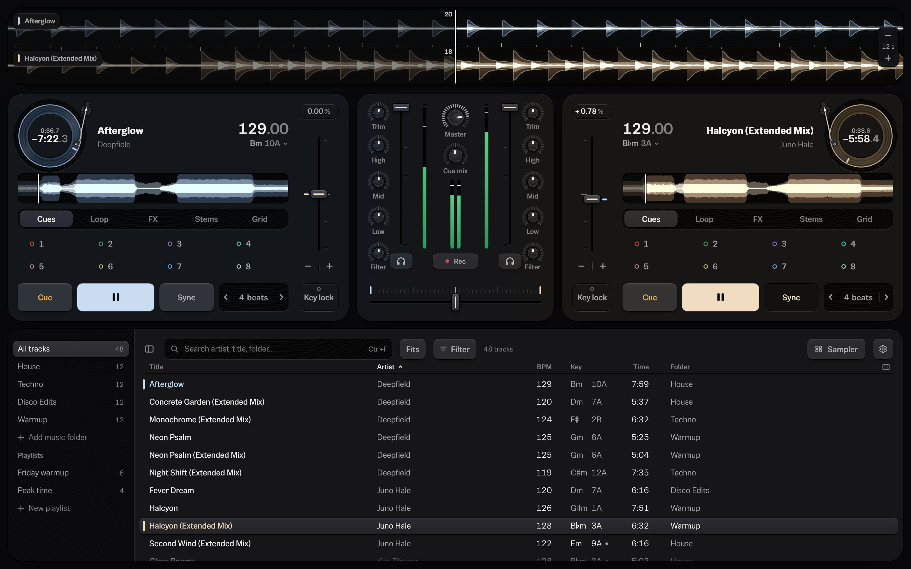

# Interlude

A free, open-source DJ app for the Mac.

**[Download Interlude](https://github.com/zain-merchant/interlude/releases/latest/download/Interlude.dmg)**
for Macs with Apple silicon (macOS 11 or later), or visit
[interludedj.com](https://interludedj.com).



Interlude is in beta. If something goes wrong, use Help › Report a Problem
and [open an issue](https://github.com/zain-merchant/interlude/issues) with
the report it saves.

## Features

- **Decks:** BPM, beatgrid and key found on load; sync that locks tempo
  and beat phase; 8 hot cues, beat loops and beat jump; slip, quantize,
  key lock, key shift and key sync; scrolling three-band waveforms with a full-track overview.
- **Mixer and effects:** trim, 3-band EQ with full kills, filter,
  crossfader, headphone cue with a cue/master blend; echo, reverb, flanger
  and phaser timed to the beat; sixteen hold-to-play pad FX (rolls,
  trans, brake, spin back, sweeps and more) on the controller's PAD FX
  pads; auto gain so tracks start level; a master
  limiter so the output never clips.
- **Stems:** mute or solo vocals, melody, bass and drums on each deck. The
  model that makes them downloads by itself after setup (166 MB), and you
  choose whether every track is separated when you load it or only when you
  use its stems. That happens on your Mac, nothing is uploaded.
- **Library:** instant search, playlists, a history of every set, and
  import from Rekordbox and Serato with cues, loops and grids. Your music
  files are never changed.
- **Controllers:** the Pioneer DDJ-FLX4 is mapped in full. More than 150
  others connect through the bundled Mixxx mappings (including untested
  ones for the DDJ-FLX6, DDJ-FLX10, DDJ-800, XDJ-RX3, XDJ-AZ and OPUS-QUAD),
  and MIDI learn covers the rest.
- **And:** set recording to WAV, an 8-slot sampler, fully remappable
  keyboard shortcuts, and MP3, AAC, FLAC, WAV, AIFF, OGG and ALAC support.

The details of every feature are in the [feature guide](docs/guide.md).

## Logs, problem reports and updates

- **Logs:** everything the app reports goes to `logs/interlude.log` in its
  data folder (on a Mac, `~/Library/Application Support/Interlude/logs`), with
  the last three sessions kept.
- **Report a problem** (Help menu, or the bottom of Settings): say what
  happened and the app saves a report to the Desktop with the version,
  system, audio device, controllers and the logs of this and the last
  session, ready to attach to an issue.
- **Updates:** the app checks for a newer version a few seconds after
  launch (and from Interlude › Check for Updates…) and offers to install it.
  It never installs or restarts while a deck is playing or a set is
  recording.

## Keyboard

The keyboard splits down the middle: the left hand plays deck A, the right
hand deck B, mirrored. Keys follow their position, so the layout keeps its
shape on AZERTY, QWERTZ and Dvorak.

| Deck A | Deck B | Action |
| --- | --- | --- |
| Q | P | Cue (hold to preview) |
| W | O | Play / pause |
| E | I | Sync on/off: lock tempo and beats to the other deck |
| Z / X | , / . | Nudge slower / faster (hold) |
| G | H | Headphone cue |
| 1 2 3 4 | 7 8 9 0 | Hot cues 1 to 4 (start a paused deck; Settings can make them hold to preview instead, Shift clears) |
| R | U | Loop on / off (snaps to the beat) |
| D / F | J / K | Halve / double the loop |
| C / V | N / M | Beat jump back / forward by the loop size |
| ⇧C / ⇧V | ⇧N / ⇧M | Jump back / forward 4 bars |
| A | ; | Slip on / off |
| Shift ← | Shift → | Load the selected track |

| Key | Action |
| --- | --- |
| B | Quantize on / off |
| S | Show / hide the sampler |
| [ / ] | Crossfader left / right (Shift snaps to the end) |
| − / = | Zoom waveforms out / in (or ⌘ + scroll on a waveform) |
| Ctrl/⌘ F | Search the library |
| ↑ / ↓, Page Up / Down, Home / End, Enter | Pick a track, load it |
| F6 / Shift F6 | Move focus between the library, decks, mixer and waveforms |
| Esc | Clear the search, or hand the keys back to the decks |
| Shift F10 | Open the right-click menu for the focused control |

Knobs and faders: drag (Shift for fine), scroll, or arrow keys (Home / End for
the ends). They snap gently at their default; Shift ignores that. Double-click
or right-click to reset. Click an EQ's label to kill that band. Hover any
control for its value and shortcut. Drag the scrolling waveforms to scratch (you hear it, like a record under
your hand; a playing deck picks back up when you let go), click or drag the
overview to jump, and drag the
line above the library to resize it.

## Architecture

```
crates/engine   Real-time audio engine (no UI). Decks, mixer, DSP, decoding,
                waveform analysis, sound card output.
crates/controller  MIDI and HID controllers: Mixxx mappings (and their
                scripts), MIDI learn, the built-in DDJ-FLX4 mapping.
crates/stems    Makes stems in the background (ONNX Runtime +
                HTDemucs), and the stems cache.
crates/cli      `dj` command-line tool for testing the engine headless.
app/            Desktop app: Tauri 2 shell (app/src-tauri) + Svelte 5 UI (app/src).
site/           The website, interludedj.com.
```

The UI never touches audio. It sends small commands to the engine through a
lock-free queue and reads state back from atomics, so a slow UI frame can't
cause a dropout. The audio thread never locks, allocates or touches the disk;
tracks are decoded up front on a worker thread and freed off the audio thread.

## Building

You need Rust (stable) and Node 20+.

**Linux** also needs: `libasound2-dev libudev-dev libwebkit2gtk-4.1-dev libgtk-3-dev librsvg2-dev`
(Debian/Ubuntu names). **macOS** and **Windows** need nothing extra beyond
the [Tauri prerequisites](https://v2.tauri.app/start/prerequisites/).
The first build downloads ONNX Runtime (for stems) through the `ort` crate;
to use a copy you already have, set `ORT_LIB_LOCATION` to its folder.

```sh
# Desktop app (dev mode with hot reload)
cd app
npm install
npm run tauri dev

# Release build / installer
npm run tauri build

# UI only, in a browser, with a simulated engine (no Rust needed)
npm run dev        # then open http://localhost:1420

# Engine tests and benchmark
cargo test
cargo run --release -p dj-engine --example bench

# Headless CLI
cargo run --release -p dj-cli -- info track.mp3
cargo run --release -p dj-cli -- play a.mp3 b.mp3          # auto-crossfade A into B
cargo run --release -p dj-cli -- render a.mp3 b.mp3 mix.wav
cargo run --release -p dj-cli -- midi                      # print what a controller sends
cargo run --release -p dj-cli -- mappings                  # list controller mappings found
```

## Running the checks

There is no hosted CI, so run these before merging a change. The Tauri crate
embeds the built UI, so build the UI first.

```sh
# UI: type and Svelte checks, then build
cd app
npm ci
npm run check
npm run build
cd ..

# Rust: formatting, lints and tests
cargo fmt --all --check
cargo clippy --workspace --all-targets --all-features -- -D warnings
cargo test --workspace
```

## Releasing

Interlude is downloaded from, and updates itself from, this repo's
[GitHub Releases](https://github.com/zain-merchant/interlude/releases).
The website's download button links to
`releases/latest/download/Interlude.dmg`, and installed copies read
`releases/latest/download/latest.json`, so both always point at the newest
(non-prerelease) release. While the repo is private, only people with
access can download.

Each update is signed with the updater key; the app only installs updates
signed with it.

1. Once: the key is in `~/.tauri/oss-dj-updater.key` on the release Mac
   (made with `npx tauri signer generate -w ~/.tauri/oss-dj-updater.key`;
   its public half is `plugins.updater.pubkey` in `tauri.conf.json`).
   Keep a copy somewhere safe, like a password manager: without it,
   installed copies can never be updated again.
2. From a clean, up-to-date `main`, on the Mac:
   ```sh
   app/scripts/release.sh 0.2.0 "What changed, in a line or two"
   ```
   It sets the version, builds and signs the app, writes `latest.json`,
   commits and tags `v0.2.0`, and publishes the release with the disk image
   (also as `Interlude.dmg`), the update bundle, its signature and
   `latest.json`. GitHub adds the source code to each release, which the
   GPL asks for.

**Apple signing.** A signed and notarized app opens without the "Apple
could not verify" warning. Set up once on the release Mac:

1. Make a certificate signing request: Keychain Access › Certificate
   Assistant › Request a Certificate From a Certificate Authority, with your
   email, "Saved to disk".
2. At [developer.apple.com › Certificates](https://developer.apple.com/account/resources/certificates/add),
   add a **Developer ID Application** certificate (G2 Sub-CA) from that
   request, download it and double-click it to add it to the login keychain.
   `security find-identity -v -p codesigning` should now list it.
3. Make an app-specific password at [account.apple.com](https://account.apple.com)
   › Sign-In and Security › App-Specific Passwords, and save it with
   `security add-generic-password -s interlude-notarize -a <Apple ID email> -w`
   (it asks for the password).

After that `release.sh` finds the certificate and the password itself, and
Tauri signs the app and sends it to Apple to notarize (a few minutes).

**The website** is `site/`, plain HTML and CSS, with no build step and no
CI. To publish or update it, push that folder to the `gh-pages` branch:
```sh
git subtree push --prefix site origin gh-pages
```
It's served at [interludedj.com](https://interludedj.com) (`site/CNAME`;
DNS at Namecheap points the domain at GitHub Pages).

**Moving over from oss-dj.** The app was called oss-dj. On first launch,
Interlude moves the old data folder (library, settings, stems, logs), the
learned controller mappings, `Music/oss-dj recordings`, and on a Mac the UI
settings, to their new places (see `app/src-tauri/src/paths.rs`).

## Roadmap

The full list of what's still missing next to rekordbox, Serato and djay is
in [docs/parity.md](docs/parity.md).

- More controllers tested and mapped in full, beyond the DDJ-FLX4.
- Crates and smart playlists.
- Windows and Linux builds.
- Later: 4 decks, HID jog displays, DVS, CDJ USB export.

## Contributing

Bug reports and pull requests are welcome. See [Building](#building) and
[Running the checks](#running-the-checks) above, and keep changes focused.
UI design notes are in [docs/design-direction.md](docs/design-direction.md).

## License

GPL-3.0-or-later. See [LICENSE](LICENSE). This keeps the door open to port
algorithms and controller mappings from Mixxx (GPL-2.0-or-later) and to use
GPL libraries such as Rubber Band and libKeyFinder.
