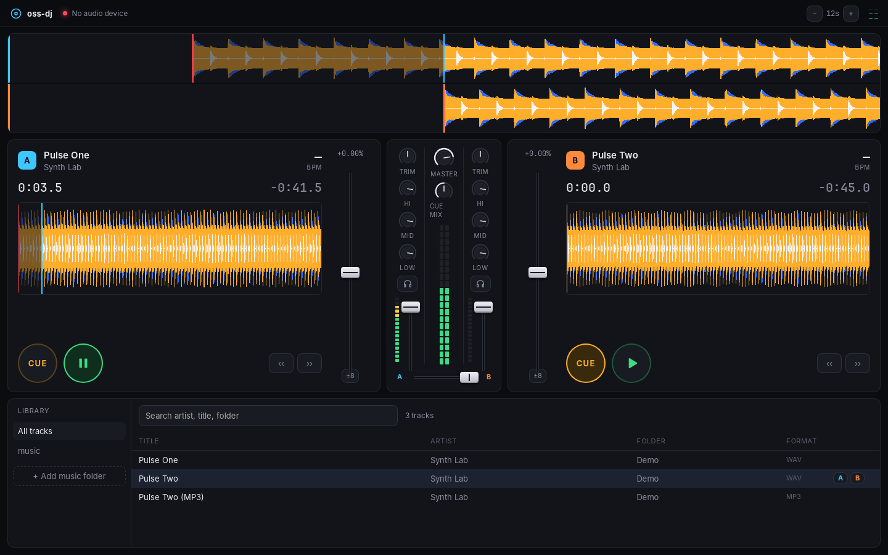

# oss-dj

A free, open-source DJ app that is fast, modern and uncluttered. No paywalled
"pro" features, no lock-in.



> **Status: early development (Phase 2 under way).** You can load two
> tracks, see their BPM, sync them, cue, change pitch, EQ and crossfade.
> The Pioneer DDJ-FLX4 works as a controller, including hot cues, loops,
> beat jump and beat FX. See the roadmap below.

## What works today

- **Audio engine (Rust):** two decks with varispeed playback, CDJ-style cue
  (set, hold to preview, play from preview), nudge, ±8/16/50% pitch.
- **Tempo:** BPM and beatgrid detected on load (about 0.2 s for a 6-minute
  track), shown on each deck and as beat lines on the waveform (a stronger
  line every 4 beats). SYNC matches tempo and beat phase to the other deck,
  picking half or double time when that's closer (e.g. 87 vs 174 BPM).
  Detection range is 80-160 BPM; constant tempo only for now.
- **Hot cues, loops, beat jump:** 8 hot cues per deck (4 on screen, all 8
  on the FLX4 pads): set, jump, hold on a paused deck to preview. Beat loops
  snap to the beatgrid, halve and double, and wrap without clicks. Beat jump
  moves by the loop size and carries an active loop with it (Shift: 4
  bars). Hot cues, the
  cue point and the loop are saved with the library as you set them, and
  come back when the track is loaded again.
- **Slip** (the Slip toggle under Key lock, A / ;, or SHIFT + PLAY on the
  FLX4): while a scratch, loop, held hot cue or pause interrupts a playing
  deck, the track keeps time underneath, shown as a fainter second play
  head on the waveform. When it ends, playback picks up where the track
  would have been, so a loop or scratch never knocks the mix out of time.
  With slip on, a hot cue pressed mid-play rolls while held. Cue, a seek
  or turning slip off ends a slip where it is.
- **Quantize** (on by default; the Quantize button in the mixer, or B):
  hot cues, the cue point, loop in and out snap to the nearest beat, and a
  hot cue or reloop pressed mid-play lands at the same point in the beat, so
  the mix stays in time. Off, everything happens exactly at the play head.
- **Mixer:** trim, 3-band isolator EQ with full kills, channel faders,
  constant-power crossfader, master gain, headphone cue with cue/master blend
  (on interfaces with 4+ outputs, headphones go to channels 3-4).
- **Effects:** a filter knob per channel (left low-pass, right high-pass,
  centre off) and a beat FX unit per deck: echo, reverb, flanger and phaser,
  timed in beats (1/8 to 8) from the deck's tempo, with level and on. Echo
  and reverb tails ring out after you switch them off.
- **Sampler:** eight one-shot slots that play straight to the master
  (past the crossfader), with one level knob. It stays out of the way: the
  Sampler button above the library (or S) opens a slim strip under the
  decks. Drag a track onto a slot to load it (up to 60 seconds), click to
  play from the top, ⇧-click to stop, right-click to clear. Slots are kept
  between sessions.
- **Recording:** the Rec button in the mixer records the master output to a
  24-bit WAV in `Music/oss-dj recordings`. The file is written off the
  audio thread and its header is refreshed every few seconds, so a crash
  still leaves a playable file.
- **Formats:** MP3, AAC/M4A, FLAC, WAV, AIFF, OGG/Vorbis, ALAC via Symphonia.
- **Waveforms:** frequency-colored (bass blue, mids amber, highs white),
  drawn on the GPU with WebGL2: scrolling view per deck plus a full-track
  overview you can click to jump.
- **Library:** add music folders, instant search across artist, title and
  folder, load with double-click, Enter, or Shift+←/→. Columns for title,
  artist, BPM, key, length and folder; click a heading to sort (again to
  reverse). Title, artist, album and genre come from the file's tags (or
  an "Artist - Title" file name). BPM, key and length are found in the
  background, one track at a time, and saved. The library lives in one
  SQLite file (`library.db` in the app's data folder, backed up daily to
  `backups/`); your music files are never changed. Rescans only re-read
  new or changed files, and a file that has gone stays listed, greyed out,
  with its cues kept.
- **Playlists and History:** make playlists in the sidebar (+ New playlist,
  or right-click a track and Add to new playlist), add tracks by dragging
  them onto a playlist or from the right-click menu, drag rows to reorder,
  and Backspace to remove. Double-click a playlist to rename it. Every
  change can be undone. History lists what you played, one entry per
  session (a gap of 4 hours starts a new one); a track counts once it has
  been on air for 30 seconds with its fader up and the crossfader open.
- **Fixing a beatgrid:** right-click a deck's BPM to halve or double it,
  put the downbeat at the play head, or move the grid 10 ms earlier or
  later; double-click the BPM to type an exact one. A grid fixed by hand is
  saved and kept when the track is analyzed again, until you pick Reset to
  detected grid. Every change can be undone.
- **Import from Rekordbox or Serato:** File › Import from Rekordbox or
  Serato… (or Settings › Library). For Rekordbox it reads a rekordbox.xml
  export (File › Export Collection in xml format, Rekordbox 5, 6 or 7) and
  brings over hot cues, memory cues, loops, beatgrids and playlists. For
  Serato DJ it finds the `_Serato_` folder (in Music, or at the top of a
  drive) and brings over crates as playlists, plus the hot cues, saved
  loops and beatgrids Serato keeps in MP3, AIFF, WAV, FLAC and M4A files.
  Both fill in empty tags. Cues or grids
  you've already set in oss-dj are never replaced, and imported grids are
  kept when a track is analyzed again. Music files aren't touched.
- **Safety:** loading onto a playing deck is blocked.
- **Controller: Pioneer DDJ-FLX4.** Plug it in (before or after starting the
  app) and it connects by itself; audio goes through its sound card, with
  headphones on its headphone jack. Mapped: play, cue, sync (SHIFT + SYNC
  changes pitch range), pitch fader (picks up the current rate after SYNC
  rather than jumping), jog wheels (top: audible vinyl-style scratching,
  forwards and backwards; outer ring: nudge while playing, audible scrub
  while paused; SHIFT + jog: fast search), trim, EQ, channel
  faders, crossfader, headphone cue, browse knob and load buttons, with
  play/cue/headphone LEDs. Pads in hot cue (SHIFT + pad clears), beat loop
  and beat jump modes (SHIFT + a beat jump pad jumps 16 times as far: 4 to
  32 bars), SHIFT + PLAY for slip; loop in, out, reloop/exit, 4-beat loop (SHIFT + IN),
  CUE/LOOP CALL halves and doubles the loop (with SHIFT: beat jump), all
  with LEDs. Sampler pad mode plays sampler slots 1 to 8 from either deck's
  pads (lit when loaded); SHIFT + pad stops a slot, or loads the selected
  library track into an empty one. CFX knobs drive the channel filters. The
  beat FX section works as in rekordbox: the channel select lever picks the
  deck (MASTER runs the effect on both), BEAT FX SELECT changes the effect
  (SHIFT goes back), BEAT ◀ ▶ the beat length, LEVEL/DEPTH the level, and
  ON/OFF switches it, lit while on (SHIFT + ON/OFF turns every effect off).
  Moving the lever takes the effect with it to the new deck.

The engine renders two playing decks at about 1% of one CPU core, and a
test guarantees the audio thread never allocates memory.

## Keyboard

The keyboard splits down the middle: the left hand plays deck A, the right
hand deck B, mirrored. Keys follow their position, so the layout keeps its
shape on AZERTY, QWERTZ and Dvorak.

| Deck A | Deck B | Action |
| --- | --- | --- |
| Q | P | Cue (hold to preview) |
| W | O | Play / pause |
| E | I | Sync tempo and beats to the other deck |
| Z / X | , / . | Nudge slower / faster (hold) |
| G | H | Headphone cue |
| 1 2 3 4 | 7 8 9 0 | Hot cues 1 to 4 (hold to preview a paused deck, Shift clears) |
| R | U | Loop on / off (snaps to the beat) |
| D / F | J / K | Halve / double the loop |
| C / V | N / M | Beat jump back / forward by the loop size |
| ⇧C / ⇧V | ⇧N / ⇧M | Jump back / forward 4 bars |
| A | ; | Slip on / off |
| Shift ← | Shift → | Load the selected track |

| Key | Action |
| --- | --- |
| B | Quantize on / off |
| S | Show / hide the sampler |
| [ / ] | Crossfader left / right (Shift snaps to the end) |
| − / = | Zoom waveforms out / in (or ⌘ + scroll on a waveform) |
| Ctrl/⌘ F | Search the library |
| ↑ / ↓, Page Up / Down, Home / End, Enter | Pick a track, load it |
| F6 / Shift F6 | Move focus between the library, decks, mixer and waveforms |
| Esc | Clear the search, or hand the keys back to the decks |
| Shift F10 | Open the right-click menu for the focused control |

Knobs and faders: drag (Shift for fine), scroll, or arrow keys (Home / End for
the ends). They snap gently at their default; Shift ignores that. Double-click
or right-click to reset. Click an EQ's label to kill that band. Hover any
control for its value and shortcut. Drag the scrolling waveforms to scratch (you hear it, like a record under
your hand; a playing deck picks back up when you let go), click or drag the
overview to jump, and drag the
line above the library to resize it.

## Architecture

```
crates/engine   Real-time audio engine (no UI). Decks, mixer, DSP, decoding,
                waveform analysis, sound card output.
crates/cli      `dj` command-line tool for testing the engine headless.
app/            Desktop app: Tauri 2 shell (app/src-tauri) + Svelte 5 UI (app/src).
```

The UI never touches audio. It sends small commands to the engine through a
lock-free queue and reads state back from atomics, so a slow UI frame can't
cause a dropout. The audio thread never locks, allocates or touches the disk;
tracks are decoded up front on a worker thread and freed off the audio thread.

## Building

You need Rust (stable) and Node 20+.

**Linux** also needs: `libasound2-dev libwebkit2gtk-4.1-dev libgtk-3-dev librsvg2-dev`
(Debian/Ubuntu names). **macOS** and **Windows** need nothing extra beyond
the [Tauri prerequisites](https://v2.tauri.app/start/prerequisites/).

```sh
# Desktop app (dev mode with hot reload)
cd app
npm install
npm run tauri dev

# Release build / installer
npm run tauri build

# UI only, in a browser, with a simulated engine (no Rust needed)
npm run dev        # then open http://localhost:1420

# Engine tests and benchmark
cargo test
cargo run --release -p dj-engine --example bench

# Headless CLI
cargo run --release -p dj-cli -- info track.mp3
cargo run --release -p dj-cli -- play a.mp3 b.mp3          # auto-crossfade A into B
cargo run --release -p dj-cli -- render a.mp3 b.mp3 mix.wav
cargo run --release -p dj-cli -- midi                      # print what a controller sends
```

## Roadmap

1. **Phase 0/1 · Playable** (now): two decks, mixer, waveforms, basic library.
   Gate: you can mix two tracks by ear for an hour.
2. **Phase 2 · DJ-ready:** BPM, beatgrid and key analysis; sync, keylock,
   quantize; saved cues; effects; recording; MIDI learn and
   Mixxx controller mapping support; SQLite library.
   Gate: a full 2-hour set on your own controller.
3. **Phase 3 · Public beta, then 1.0:** Rekordbox and Serato import, crates,
   history; top 10 controllers tested; installers for macOS, Windows, Linux.
4. **Beyond 1.0:** stems, 4 decks, samplers, HID jog displays, DVS, CDJ USB
   export.

## License

GPL-3.0-or-later. See [LICENSE](LICENSE). This keeps the door open to port
algorithms and controller mappings from Mixxx (GPL-2.0-or-later) and to use
GPL libraries such as Rubber Band and libKeyFinder.
